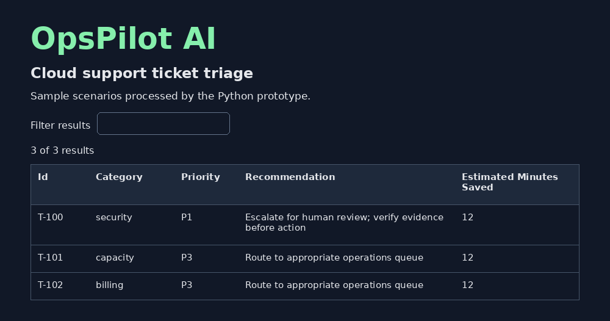

# OpsPilot AI

Turn a cloud support queue into categorized tickets with suggested next steps and an estimate of triage time saved.

[Open the live demo](https://lolstershwjav.github.io/opspilot-ai/)

[](https://lolstershwjav.github.io/opspilot-ai/)

## Try the demo

Enter `P1` in **Filter results**. Ticket `T-100` describes an exposed token. The prototype routes it to security and recommends human review. Clear the filter to see capacity and billing examples.

## How it works

Keyword scoring assigns the category. Security tickets and outage mentions receive P1 priority. The time estimate assumes three minutes of assisted triage per ticket.

The public demo filters precomputed results from synthetic examples. The Python prototype runs locally and requires no cloud credentials. Operational decisions require human review.

## Run locally

```bash
python3 demo_report.py
python3 -m http.server --directory docs
```

Open `http://localhost:8000` to preview the demo. To run the tests in a virtual environment, install `requirements.txt` and run `python -m pytest -q`.

## Deployment

GitHub Pages serves `docs/` from `main`. The preview image reproduces the demo’s published sample table.

## Roadmap

1. Add an optional LLM explanation adapter with schema validation and prompt-injection resistance.
2. Connect read-only cloud telemetry or ticket APIs with scoped credentials.
3. Build a FastAPI endpoint and TypeScript dashboard to collect user feedback and adoption metrics.
4. Add CI, structured logs, deployment documentation and measured before/after results.
